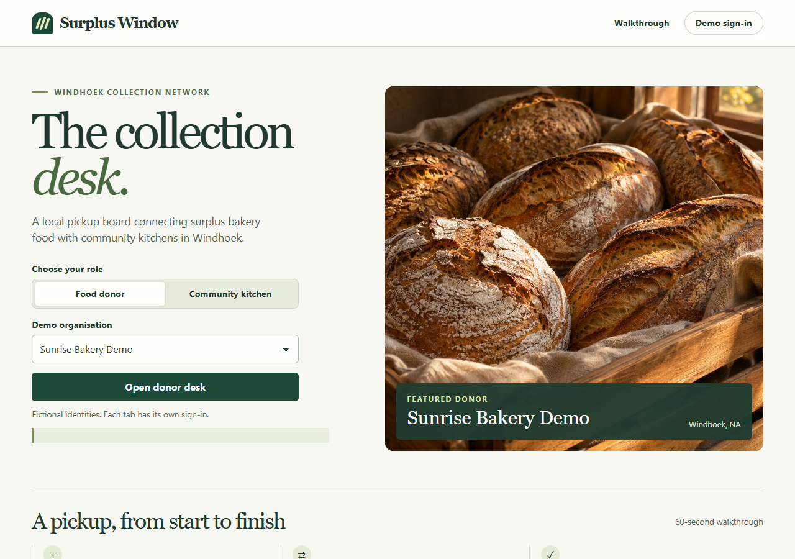
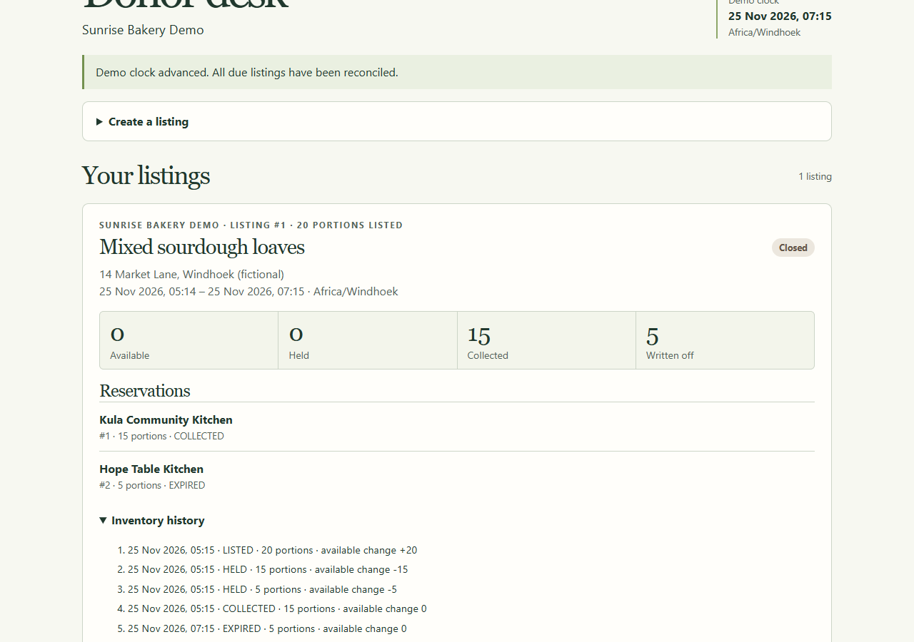

# Surplus Window

Bakery food can go to waste when collection teams cannot see what is still available or reserve it in time. Surplus Window is a local coordination app for a fictional Windhoek bakery and three community kitchens. The bakery lists a pickup window, kitchens hold portions, and the donor confirms the physical handover. The donor’s ledger accounts for every portion when collection ends.

It uses Node.js, Express, SQLite through `better-sqlite3`, and plain HTML, CSS and browser JavaScript. The demo includes concurrent HTTP reservations, 30-minute holds, deadline reconciliation, role-scoped access and safe action retries.





## Windows quick start

Run in PowerShell with Node.js 22.16 or newer. Clone the repository, then install dependencies. The project contains the frontend, API, migrations and fixtures. Cloning and dependency installation need internet access.

```powershell
git clone https://github.com/OP-glich/surplus-window.git
Set-Location .\surplus-window
npm.cmd ci
node -e "const Database=require('better-sqlite3'); const db=new Database(':memory:'); console.log('SQLite',db.prepare('SELECT sqlite_version() AS version').get().version); db.close()"
npm.cmd run setup
npm.cmd test
npm.cmd run demo
```

Open [the collection desk](http://127.0.0.1:3000/) in two independent browser tabs. Both tabs start at the same home page. Sign in once in each. The specialised pages are [the donor desk](http://127.0.0.1:3000/donor.html) and [the kitchen desk](http://127.0.0.1:3000/kitchen.html). The server binds to IPv4 loopback. To check it from another PowerShell window, run:

```powershell
Invoke-RestMethod 'http://127.0.0.1:3000/api/health'
```

### 60-second walkthrough

1. In the first tab, choose **Food donor**, **Sunrise Bakery Demo**, then **Open donor desk**. The seeded listing is **Mixed sourdough loaves**, with 20 portions available.
2. In the second tab, choose **Community kitchen**, **Kula Community Kitchen**, then **Open kitchen desk**. Enter **15** under **Whole quantity** and click **Reserve**.
3. Click **Demo: race for the last five** on that listing. The browser signs in Hope Table Kitchen (B) and Eagle Street Meals (C) separately and starts both reservation requests together. Read the actual responses below the button. One kitchen receives HTTP 201 and holds five. The other receives HTTP 409 with `insufficient_stock`. The current tab stays signed in as Kula.
4. In the donor tab, find **Kula Community Kitchen** and click its **Confirm handover** button. Leave the winner’s five portions held.
5. Click **Jump to pickup deadline**. Read the four totals and expand **Inventory history** to see the closing event.

| Moment | Available | Held | Collected | Written off |
| --- | ---: | ---: | ---: | ---: |
| Listed | 20 | 0 | 0 | 0 |
| Kula reserves | 5 | 15 | 0 | 0 |
| Race completes | 0 | 20 | 0 | 0 |
| Kula collects | 0 | 5 | 15 | 0 |
| Deadline | **0** | **0** | **15** | **5** |

### Normal operation and a fresh demo

- `npm.cmd start` uses real time and `data/surplus.sqlite`. The clock-changing route is disabled. Stop the current server with **Ctrl+C** before switching modes on the same port.
- `npm.cmd run demo` uses `data/demo.sqlite`. Its clock stays at the displayed time until the donor jumps to a selected listing’s actual deadline. That moves the shared clock forward for every tab and listing. The clock is in SQLite and survives restarts.
- `npm.cmd run setup` and `npm.cmd run seed` apply outstanding migrations and insert missing fixtures into the normal database. Existing reservations, events and listings survive. Each server also prepares its own selected file on startup.
- For a fresh demonstration tomorrow, stop the demo, run the two commands below and sign in again. Reset replaces all records **only in the designated demo file** and creates a new 20-portion window.

```powershell
npm.cmd run reset:demo
npm.cmd run demo
```

The default port is 3000. An optional `.env` can be created with `Copy-Item .env.example .env`. Edit `PORT` there if needed. Data files, local settings, npm cache and installed dependencies are ignored by Git. After installation, the app runs offline and serves its own image, scripts and styles.

## Architecture

```text
Donor tab                Kitchen tab
   └────────── HTTP ──────────┘
                │
         Express, 127.0.0.1
         ├── public/ (HTML, CSS, browser JS)
         └── /api → session and role checks
                       │
               inventory transactions ← injected clock
                       │
                  better-sqlite3
                       │
             one SQLite file per mode
              + WAL and foreign keys
```

`src/routes/` handles HTTP and resource ownership. `src/services/` owns reservation, expiry, handover, event and retry logic. Versioned SQL lives in `migrations/`. Setup and reset live in `scripts/`. Node’s test runner starts real loopback HTTP servers against temporary SQLite files under the ignored `.work/` directory.

### How the inventory works

**The last five.** A stock-changing operation begins with `BEGIN IMMEDIATE`. Once it holds the write lock, it reads the clock once. The reservation updates availability only if the listing is still open **and** it has enough stock. The row-change count decides whether to create a hold. Two simultaneous HTTP requests for the same five portions cannot both satisfy that condition. The hold, stock change, event and successful retry record commit together.

**The deadline.** All stored timestamps are integer UTC epoch milliseconds. Both desks display Africa/Windhoek time. A pickup window includes its start and excludes its deadline. A hold ends at the earlier of 30 minutes after reservation or the pickup deadline. Before closing, expiry or cancellation transitions a still-held row once and returns its quantity to availability. A handover changes held portions to collected and records a zero change in availability.

**Closing.** The first reconciliation at or after the deadline expires remaining holds without releasing them. It records available plus still-held as written off, sets availability to zero, and closes the listing. A unique index permits one closing event, even for a zero write-off. Event quantity and availability delta are separate columns. In the walkthrough, the closing event has quantity **5** and availability delta **0**. Reconciliation happens on startup, every three seconds and before expiry-sensitive reads and writes. An expected rejection rolls the action back to a savepoint and lets the outer transaction commit the deadline work.

**Retries.** Each successful action stores its original HTTP status and JSON response under an actor-scoped key. Its fingerprint covers method, operation, concrete target and canonical JSON body. Role and ownership checks run before replay. The browser saves a pending action and its key in tab-local storage before sending. A lost response offers **Retry this action**, including after a refresh. The same action replays its original result after the deadline. A different target or body with the same key returns HTTP 422.

**Identity.** Selecting a seeded organisation is a local demonstration login. The server issues a random bearer token and stores its hash. Each tab keeps its own session in `sessionStorage`. Every protected API request checks the token. Sunrise Bakery and West Mill Bakery Demo can manage only their own organisations’ listings and handovers. Each kitchen can read and cancel its own reservations. All names, pickups and transactions are fictional.

**Interview trade-off.** One local Express process and one database keep deployment small and make the transaction boundary easy to explain. SQLite permits one writer at a time. Synchronous database work briefly occupies Node’s event loop, including a lock wait of up to 2.5 seconds. A busy installation with sustained writes or several app servers would benefit from a shared database server and a coordinated expiry worker.

## Local verification

Windows x64 runtime used for this handoff: Node **26.13.0**, npm **11.20.0**, Express **5.1.0** and Google Chrome **157.0.8103.79**. The lockfile pins **better-sqlite3 13.2.0** and its **node-addon-api 8.5.0** dependency.

On Windows, the installed `better-sqlite3` driver loaded successfully with SQLite **3.54.1**. `npm.cmd run setup` succeeded and `npm.cmd test` passed **21 of 21** tests with the native driver. The demo server launched with `PORT=3002` because another local process occupied port 3000.

The tests cover the repeated HTTP race, stock and ledger totals, cancellation, exact start/expiry/deadline boundaries, closing with zero or mixed stock, startup and periodic sweeps, restart equivalence, rollback on an injected write failure, response replay, changed ownership, cross-organisation requests, invalid quantities, setup preservation and mode permissions. The race measures simultaneous requests to one HTTP server. Independent-connection lock contention was outside that test.

A separate Windows Chrome walkthrough exercised two tabs, verified that a typed quantity survived polling, and ran the race on an isolated database. Hope Table received 201, Eagle Street received 409, and the donor’s final balance was **0 available, 0 held, 15 collected, 5 written off**. The kitchen view also fit a 390-pixel viewport. Its test records were isolated from the fresh handoff listing. All execution checks took place on Windows.

The demo command uses the native driver. Port 3000 is the default. Set `$env:PORT='3002'` in PowerShell before `npm.cmd run demo` when port 3000 is occupied.

The bread photograph is an original AI-generated project asset stored in `public/assets/`.
